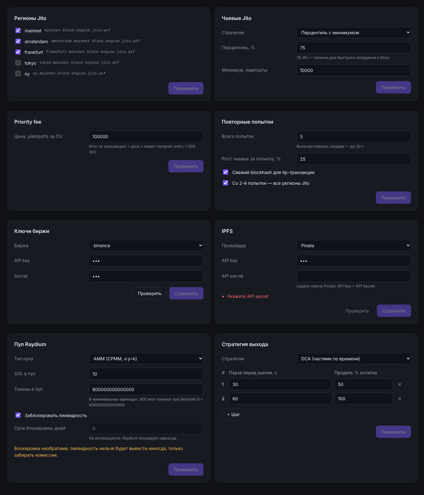

# Панели настроек (React)



8 компонентов, каждый в своём файле, плюс общий модуль и стили:

| Файл | `value` | Что сохраняет |
|---|---|---|
| `src/JitoRegionsConfig.tsx` | `JitoRegion[]` | `{ jitoRegions }` |
| `src/TipStrategyConfig.tsx` | `{ type, lamports?, percentile?, minLamports? }` | `{ tipStrategy }` — готовый `TipStrategy` для `calculateTip` |
| `src/PriorityFeeConfig.tsx` | `number` | `{ priorityFeeMicroLamports }` |
| `src/RetryConfig.tsx` | `RetryConfig` | `{ retry }` |
| `src/ExchangeKeysConfig.tsx` | `{ exchange, apiKey, secret }` | `{ exchangeKeys }`; «Проверить» → `onValidate({ exchangeKeys })` |
| `src/RaydiumConfig.tsx` | `RaydiumConfig` | `{ raydium }` |
| `src/TradingConfig.tsx` | `TradingConfig` | `{ trading }` |
| `src/IpfsConfig.tsx` | `IpfsConfig` | `{ ipfs }`; «Проверить» → `onValidate({ ipfs })` |
| `src/settings_form.tsx` | — | общий `ConfigProps<T>`, хук черновика, поля, кнопки |
| `src/settings.css` | — | тёмная тема: `.panel`, `.btn`, `.field-grid`, `label`, `input` |

## Что изменено/дополнено относительно ТЗ и почему

### 1. `value` типизирован, а не `any`
`ConfigProps<T>` — тот же интерфейс из ТЗ (`value`, `onSave`, `onValidate`, `busy`), но `value`
у каждой панели своего типа. Типы взяты из модулей бэкенда (`RetryConfig` из
`submit_with_retry.ts`, `RaydiumConfig` из `raydium.ts` и т.д.): если поле в бэкенде поменяется,
TypeScript покажет, какую панель править.

### 2. Ключи в `onSave` для панелей 4–8
Для 1–3 ключи были в ТЗ. Для остальных выбраны по смыслу: `retry`, `exchangeKeys`, `raydium`,
`trading`, `ipfs`. Тот же патч уходит и в `onValidate`. Если на бэкенде другие имена — это одна
строка в каждом файле.

### 3. Raydium: добавлено поле «Токены в пул», срок блокировки только для чтения
После прошлой задачи `initialLiquidityTokens` обязателен (без него не задать стартовую цену),
поэтому в панели есть такое поле — в минимальных единицах, в `onSave` уходит `bigint`.
`lockPeriodDays` показан, но заблокирован с подсказкой: Raydium блокирует навсегда. При
включённой блокировке видно предупреждение о необратимости.

> **`bigint` не сериализуется в JSON.** Если патч уходит на сервер через `JSON.stringify`,
> преобразуйте `initialLiquidityTokens` в строку перед отправкой (и обратно на сервере).

### 4. DCA: паузы в секундах
В конфиге `trading.ts` время в миллисекундах; в форме — в секундах, при сохранении умножается
на 1000. Проверяется лимит 5 минут на сумму пауз. Если последний шаг не 100 %, показывается
предупреждение, что часть токенов останется.

### 5. Проверки в форме совпадают с бэкендом
Кнопка «Применить»/«Сохранить» неактивна, пока есть ошибка; текст ошибки — под полями:
- чаевые ≥ 1000 лампортов (минимум Jito), перцентиль ∈ (0, 100];
- priority fee — целое ≥ 0, потолок 10 000 000 µlamports/CU от опечатки;
- попыток 1–10, рост чаевых 0–500 %;
- хотя бы один регион Jito включён;
- IPFS — только Pinata (Arweave есть в списке, но помечен как неподдерживаемый, как в `ipfs.ts`);
- trailing ∈ (0, 100), целевая цена > 0, DCA — как в `trading.ts`.

### 6. Поведение форм
- **Черновик** (`useState`): правки не уходят наружу до нажатия кнопки.
- **«Применить» неактивна без изменений**; при `busy` неактивно всё, на кнопке «Сохранение…».
- **Новое `value` сбрасывает форму, только если изменилось содержимое.** Если родитель при
  каждом рендере передаёт новый объект с теми же данными, ввод пользователя не сотрётся.
- **«Проверить»** показывает «Подключение работает» или список ошибок; исключение из
  `onValidate` тоже показывается. Любая правка формы сбрасывает результат проверки, чтобы «ОК»
  не относилось к уже другим ключам.
- Секреты — `type="password"`, `autocomplete="off"`.
- Доступность: у каждого поля `<label for>`, ошибки — `role="alert"`.

### 7. Зависимости и сборка
- Добавлены `react`, `react-dom` 19; для тестов — `jsdom`, `@testing-library/react`.
- В `tsconfig.json` включены `"jsx": "react-jsx"` и типы DOM. Бэкенд-код с ними компилируется
  как раньше.
- CSS **не импортируется** из компонентов, чтобы `tsc` и тесты работали без бандлера.
  Подключите `settings.css` один раз в приложении.

## Как встроить в код

```tsx
import './settings.css';
import { IpfsConfig } from './IpfsConfig';
import { RetryConfig } from './RetryConfig';

function SettingsPage({ settings, save, validate, saving }: Props) {
  return (
    <>
      <RetryConfig value={settings.retry} onSave={save} onValidate={validate} busy={saving} />
      <IpfsConfig value={settings.ipfs} onSave={save} onValidate={validate} busy={saving} />
      {/* … остальные панели */}
    </>
  );
}
```

- **`onSave(patch)`** получает объект с одним ключом — мёржите его в общий конфиг
  (`setSettings((s) => ({ ...s, ...patch }))`) и отправляйте на сервер.
- **`onValidate`** для `exchangeKeys` и `ipfs` выполняйте **на сервере**. Для IPFS это
  `testIpfsConnection(patch.ipfs)` → `{ ok, errors: ok ? [] : ['Ключи Pinata не работают'] }`.
  Ключи не должны проверяться из браузера напрямую.
- **Секреты в браузере.** Панели получают ключи в `value`, чтобы их можно было показать и
  изменить. Безопаснее отдавать с сервера пустые строки (или маску) и сохранять ключ, только
  если пользователь ввёл новый.
- **`busy`** держите `true`, пока идёт сохранение; после ответа сервера передайте новое `value` —
  форма сбросится, кнопка снова станет неактивной.
